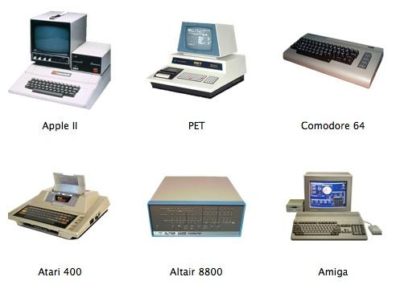
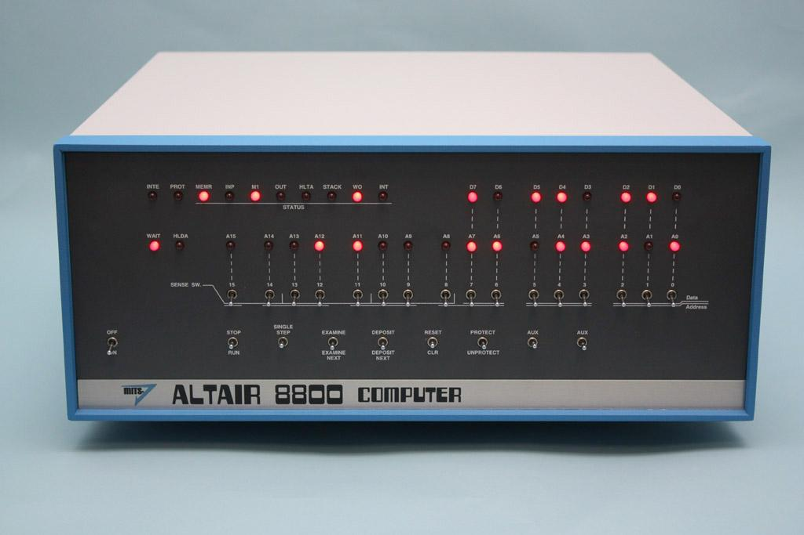
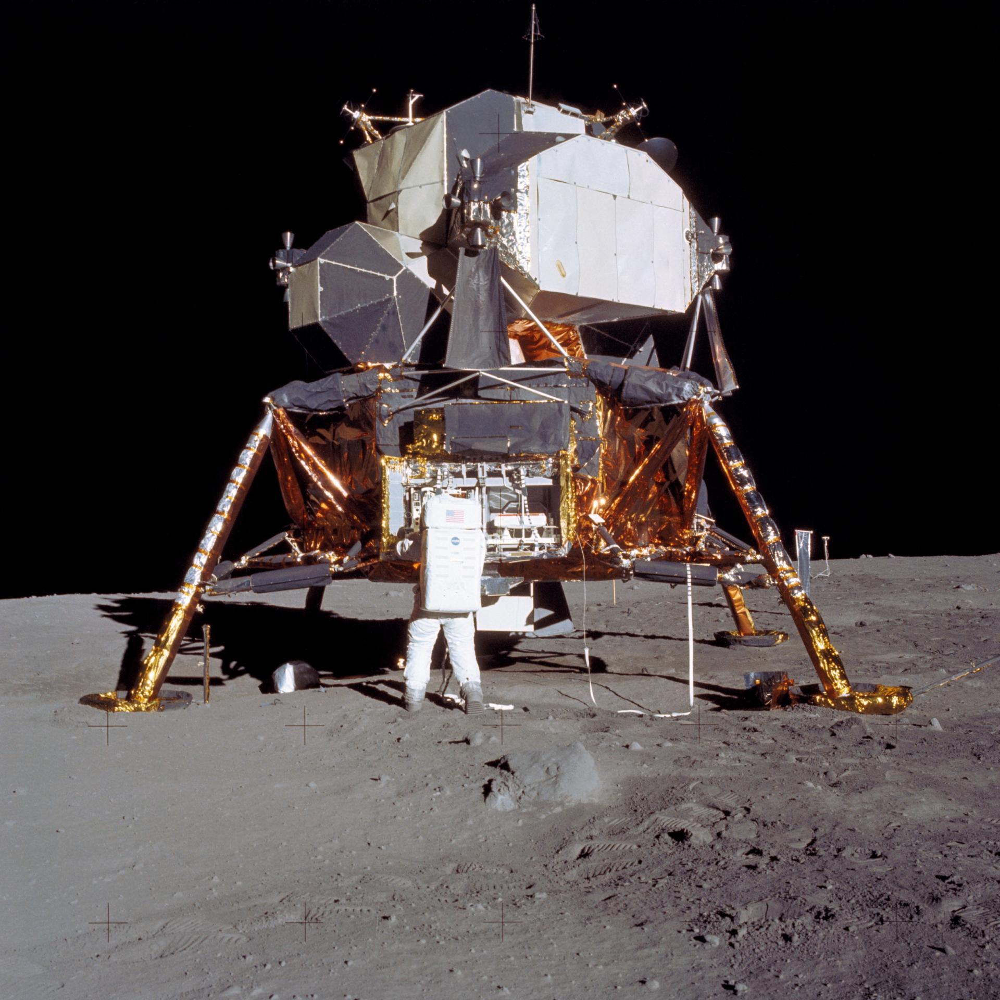
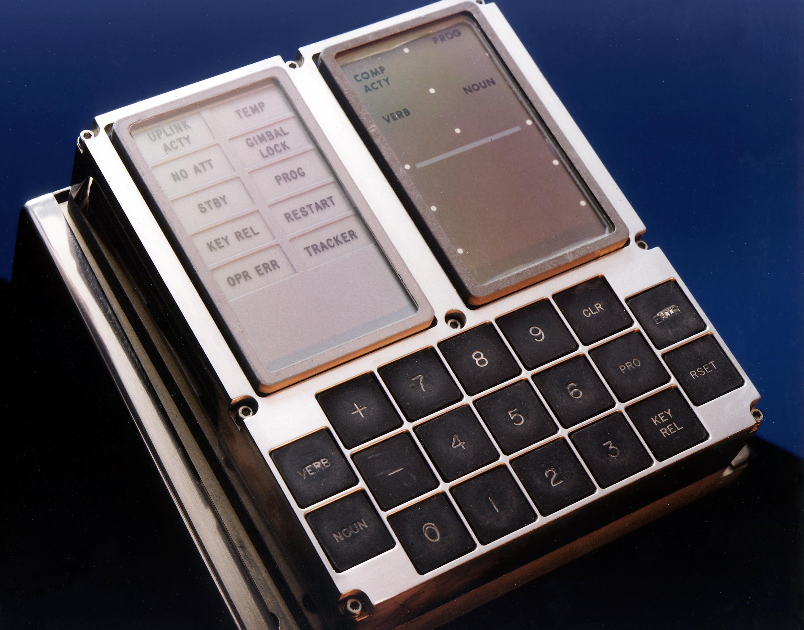
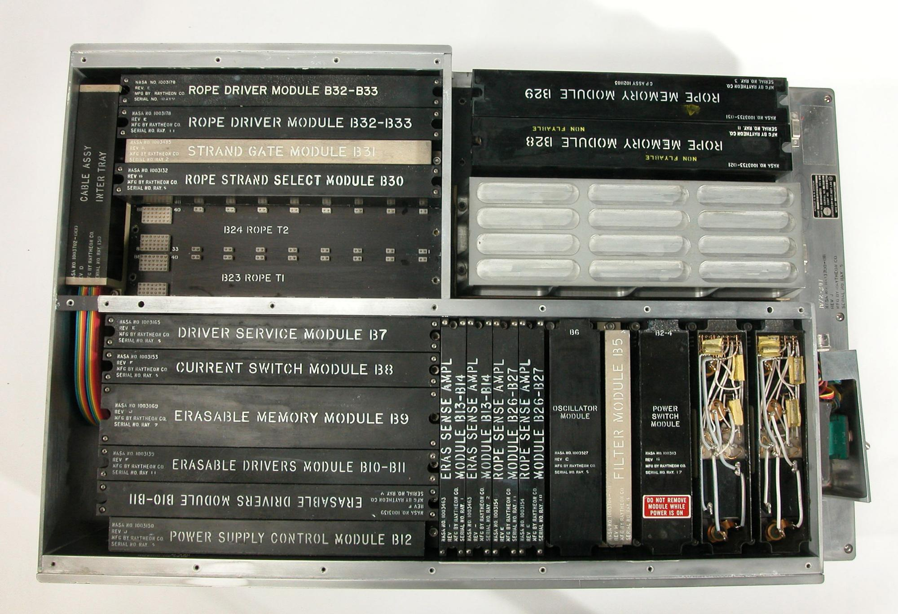

# RetroFPGA Computer Museum

## Opening Section — Project Introduction

## 🌐 RetroFPGA Computer Museum — An Open-Source Computing Heritage Project
**One FPGA. One Computer. One Era at a Time.**

The RetroFPGA Computer Museum is an open-source engineering, educational, and digital preservation initiative dedicated to rebuilding the world's computing heritage through Field-Programmable Gate Array (FPGA) technology.

From pioneering microprocessors and classic home computers to commercial mainframes, industrial systems, military computers, aerospace navigation equipment, spacecraft guidance systems, and legendary video game consoles, our mission is to bring historical computing architectures back to life.

As original hardware becomes increasingly rare, expensive, and difficult to maintain, FPGA technology offers a powerful way to preserve the digital logic and engineering knowledge behind these remarkable machines.

**Our goal is not simply to display vintage computers, but to make their architectures accessible, understandable, and operational for future generations.**

### 🔗 Explore the Project on GitHub
[**RetroFPGA Computer Museum — GitHub**](https://github.com/johnschoolworks/RetroFPGA-Computer-Museum)

Explore the development roadmap, FPGA implementations, educational tutorials, technical documentation, and planned exhibits.

We welcome engineers, students, educators, researchers, and vintage computing enthusiasts from around the world to follow our progress and help preserve computing history.

## Historic Computer Gallery

These classic systems represent the kinds of machines the museum aims to reconstruct and study through FPGA-based preservation.

<div align="center">
  <table>
    <tr>
      <td align="center">
        <br>
        <b>Classic Computer Collection</b>
      </td>
      <td align="center">
        <br>
        <b>Altair 8800</b>
      </td>
      <td align="center">
        <br>
        <b>Apollo Lunar Module</b>
      </td>
    </tr>
    <tr>
      <td align="center">
        <br>
        <b>Apollo Guidance Computer Display</b>
      </td>
      <td align="center">
        <br>
        <b>Apollo Guidance Computer Modules</b>
      </td>
    </tr>
  </table>
</div>

## Why This Museum Exists: Preserving Computing Heritage

Historic computers are becoming increasingly difficult to **find, acquire, maintain, and operate**. Many surviving machines are decades old. Their capacitors, storage media, keyboards, displays, power supplies, and custom chips may fail; replacement parts are scarce, costly, or no longer manufactured. Working examples can be expensive, geographically inaccessible, restricted to institutions, or too fragile for frequent hands-on demonstrations. This is especially true for specialized industrial controllers, mainframes, aerospace and spacecraft computers, and historically significant defense systems. Even when the hardware survives, software, documentation, and the knowledge required to operate it can disappear.

**RetroFPGA Computer Museum exists because preserving physical machines alone is not enough—and obtaining every original machine is not realistic.** By reconstructing their digital logic in FPGA hardware, the project aims to make historic computing architectures accessible to students, developers, researchers, and enthusiasts without requiring a rare, working original for every exhibit.

FPGA recreation is **a complement to physical preservation, not a replacement for it**. An FPGA implementation cannot preserve the original machine's materials, industrial design, analog behavior, or every undocumented quirk. The museum will therefore document original hardware, schematics, software, historical context, and differences between each reconstruction and its reference system. Wherever practical, exhibits will favor reproducibility, repairability, open documentation, and hands-on learning.

## Vision

RetroFPGA Computer Museum is an open, FPGA-first educational project dedicated to reconstructing, studying, and operating historic computer architectures across the world—from early scientific and industrial machines to commercial systems, home computers, aerospace and spacecraft computers, defense computing, game consoles, and modern open instruction sets.

The museum is designed around **working exhibits**, not screenshots: each exhibit should eventually let visitors load a program, inspect CPU state, and interact with real logic running on an FPGA.

The guiding principle is **one exhibit at a time, not every exhibit in one bitstream**. This keeps the museum expandable without exhausting FPGA resources.

## Five Eras of Computing

The eras are **curatorial periods**, not strict CPU-bit-width boundaries. A processor's release year and the era in which a complete system became influential may differ; exhibits should document both.

| Era | Period | Theme | Example exhibits |
| --- | --- | --- | --- |
| **I — Computing Pioneers** | 1940–1976 | Foundations of computing and early microprocessors | SAP-1 (educational model), Intel 4004/8008/8080, Altair 8800 |
| **II — 8-bit Golden Age** | 1977–1986 | Home computing and the rise of personal computers | MOS 6502, Z80, Apple II, ZX81, Commodore 64, NES, IBM PC/XT, PC/AT |
| **III — 16/32-bit Revolution** | 1987–1994 | Larger address spaces, graphical systems, and advanced home computers | 80386/80486, Motorola 68000 family, Amiga, Atari ST, Macintosh, Game Boy, SNES |
| **IV — Multimedia & Internet** | 1995–2005 | Mainstream multimedia PCs, 3D graphics, and networked computing | Pentium-family PCs, PowerPC systems, PlayStation, Nintendo 64 |
| **V — Modern & Open Computing** | 2006–present | SoCs, 64-bit computing, and open hardware | ARM, RISC-V, x86-64 concepts, FPGA SoC experiments |

**Historical note:** These dates organize the museum; they do not imply that every listed processor debuted in that period. For example, the 80286 debuted in 1982, the 80386 in 1985, and the Pentium in 1993.

## Global Scope: East, West, and Beyond

This is a **world computing heritage project**, not a museum limited to American home computers or the Western personal-computer timeline. It aims to represent computing traditions and innovations from **North America, Europe, East Asia, the former Soviet Union, and other regions**, while acknowledging international collaboration, technology transfer, and parallel invention.

Exhibits are organized along **three independent axes**:

1. **Historical era:** the five periods above, with actual release dates recorded separately.
2. **Geographic and historical context:** where a machine was designed, manufactured, deployed, and influential; a machine may belong to multiple regions.
3. **Application domain:** what the computer was built to do, not merely whether it was sold for home use.

### Computing Domains

| Gallery | Scope | Illustrative historical candidates (not completed FPGA exhibits) |
| --- | --- | --- |
| **Scientific & Educational** | Early computing, university machines, teaching CPUs, scientific instrumentation | EDSAC, PDP-8, SAP-1 educational designs, Hack CPU |
| **Home & Personal** | Home microcomputers, personal computers, regional computing ecosystems | Apple II, Commodore 64, ZX81, BBC Micro, NEC PC-8801/PC-9801, Fujitsu FM-7, Sharp X68000 |
| **Commercial & Enterprise** | Business data processing, minicomputers, mainframes, workstations, point-of-sale | IBM System/360, DEC PDP-11/VAX, IBM PC/AT, selected business workstations |
| **Industrial & Embedded** | Factory automation, PLC concepts, process control, instrumentation, embedded controllers | Early programmable controllers, industrial microprocessor boards, 8051-based controllers |
| **Aviation & Aerospace** | Aircraft navigation, flight computers, avionics, launch-vehicle guidance | Publicly documented avionics architectures and historical guidance-computer designs |
| **Spacecraft & Space Exploration** | Crewed spacecraft, satellites, probes, onboard guidance and control | Apollo Guidance Computer, selected publicly documented spacecraft computers |
| **Defense & Military Computing** | Historical command-and-control, navigation, radar processing, rugged computing | Publicly documented historical systems such as SAGE and selected military computer architectures |
| **Games & Interactive Entertainment** | Arcade hardware, dedicated consoles, handhelds, video and sound chips | Atari 2600/7800, NES, Game Boy, Sega Mega Drive, SNES, PlayStation (research) |

The table contains **eight galleries**: scientific/educational computing is retained as its own category alongside the seven application areas. A single machine may appear in multiple galleries—for example, a processor can be used in both industrial and spacecraft systems.

### Regional Computing Heritage

- **North America:** early electronic computing, IBM and DEC systems, home computers, industrial control, aerospace, and console history.
- **Western and Northern Europe:** EDSAC, Sinclair, Acorn/BBC Micro, Amiga-era ecosystems, industrial and scientific computing.
- **Japan and East Asia:** NEC PC-88/PC-98, Fujitsu FM series, Sharp MZ/X1/X68000, MSX ecosystems, Japanese arcade and console hardware, and additional systems from Taiwan, Korea, and China as sources permit.
- **Soviet and Eastern European computing:** BESM, ES EVM, Elektronika, BK series, and regional industrial and scientific systems, subject to accessible documentation.
- **Other regions:** historically important locally developed or adapted computing systems, with research and contributors encouraged to fill gaps in the collection.

Regional categories are research guides, **not claims of exclusive national origin**. Catalog entries should cite primary sources where possible, distinguish documented facts from reconstruction assumptions, and avoid treating one region as the default history of computing.

### Specialized-Hardware Preservation and Responsible Reconstruction

Industrial, aerospace, spacecraft, and military computers may be harder to obtain than consumer hardware because surviving units are rare, institutionally held, expensive, physically delicate, or inadequately documented. Some designs also involve proprietary information, export controls, safety-critical behavior, or classified details.

The museum will use **lawfully available, public, and appropriately licensed information only**. It will not seek restricted schematics, protected firmware, or operational military capabilities. Historical defense and flight-computer exhibits are intended for **education, architectural study, and preservation**, not deployment in weapons, aircraft, or spacecraft. Reconstructions are **not certified flight, industrial-safety, or mission-critical hardware**.

Each specialized exhibit should explicitly state its evidence level: **documented reconstruction**, **partial subsystem**, **architectural demonstration**, or **conceptual simulation**. Where sources are incomplete, the museum should say so rather than invent missing functionality.

### Experimental Computing Gallery

Teaching and fictional architectures are presented separately from historical product timelines:

- **SAP-1 / Ben Eater-style educational CPU**
- **Hack CPU** from *nand2tetris*
- **DCPU-16** from *0x10c*
- Original experimental CPUs and peripherals

These exhibits can be cross-linked to an era based on the concepts they teach without being described as commercial computers from that era.

## FPGA Platforms: Entry-Level Through High-End

The museum is **FPGA-first and multi-tier**. The **Digilent Basys 3 remains the primary development and educational baseline**, but the museum will also support **mid-range and high-end FPGA platforms** so later computing eras are not artificially constrained by the resources of an entry-level board.

| Tier | Platform / candidate family | Role | Typical targets |
| --- | --- | --- | --- |
| **Foundation** | **Digilent Basys 3 — Artix-7 XC7A35T** | **Primary development and teaching platform**; VGA, switches, buttons, 7-segment, USB-JTAG/UART | ERA I–II cores, simple complete systems, CPU education |
| Foundation / exploration | RealDigital Boolean Board — Spartan-7 XC7S50 | Secondary board, alternative video interfaces and portability tests | Selected ERA I–II exhibits |
| SoC / exploration | Digilent Zybo Z7-10 — Zynq-7000 | ARM + FPGA co-design, control-plane and peripheral experiments | Selected cross-era or SoC exhibits |
| **Mid-range expansion** | Larger Artix-7 / Kintex-7, AMD Artix UltraScale+, or comparable Intel FPGA boards | More logic, BRAM, memory bandwidth, I/O, and external RAM | More complete ERA III systems; selected ERA IV components |
| **High-end research** | AMD Kintex/Virtex UltraScale(+) or comparable high-capacity Intel FPGA platforms | Large CPU/system reconstructions, complex memory and video subsystems | Selected ERA IV–V research exhibits and partial reconstructions |

*Mid-range and high-end families are **candidate targets**, not boards already owned, purchased, supported, or verified. Exact boards will be selected only after evaluating cost, available toolchains, logic resources, external DDR/SDRAM, video interfaces, licensing, and build reproducibility.*

### Platform allocation by era

- **ERA I–II:** Basys 3 first; move individual exhibits only when measured requirements demand it.
- **ERA III:** Basys 3 for CPU-focused demonstrations; mid-range FPGA with external memory for fuller 16/32-bit computer reconstructions.
- **ERA IV:** Mid-range or high-end FPGA depending on CPU, chipset, multimedia, and memory requirements. Full original-system compatibility is not assumed.
- **ERA V:** High-end FPGA or FPGA SoC for **selected educational, open-ISA, or subsystem-level demonstrations**. A complete modern commercial CPU/PC is not a promised deliverable.

**One FPGA does not need to contain the entire museum.** Each exhibit may have its own bitstream, memory image, supported-board matrix, and resource budget. Higher-end hardware extends the collection without displacing the accessible Basys 3 learning path.

## Architecture

```text
Linux Host
  ├── Museum CLI / exhibit catalog
  ├── Toolchains and assemblers
  ├── Bitstream manager ──────────────── USB-JTAG ─┐
  └── ROM / program uploader + debugger ─ USB-UART ┤
                                                    ▼
                                         FPGA Museum Platform
                                         ├── Clock / reset
                                         ├── VGA / PS/2 / UART
                                         ├── Buttons / switches / 7-segment
                                         └── Active exhibit bitstream
                                             ├── CPU or complete system
                                             ├── Memory and peripherals
                                             └── Debug / monitor interface
```

### Two different loading operations

1. **FPGA configuration:** Select a hardware exhibit and load its **bitstream** using JTAG. Different CPU or computer implementations may have different bitstreams.
2. **Program loading:** While a compatible exhibit is running, send a **ROM/RAM image** over UART (or another supported interface). This does **not** require re-synthesizing the FPGA.

A traditional SAP-1 has only **16 bytes** of addressable memory. A UART loader for it is a useful educational milestone, but larger applications such as Tetris require a more capable CPU/system or a separate hardware implementation.

### Why not synthesize everything together?

Inactive hardware modules still consume FPGA resources when they are included in the same bitstream. The current SAP-1/Calculator/Tetris integration has demonstrated why a modular, per-exhibit design is preferable to one giant top-level implementation.

## Exhibit Design Standard

Each exhibit should aim to include:

- **Identity:** name, historical context, release year, era, region(s), domain gallery/gallery memberships, and technical notes.
- **Hardware:** synthesizable RTL, top-level integration, constraints, memory map, and supported boards.
- **Software:** assembler/toolchain information, sample programs, ROM images where redistribution is permitted.
- **Interaction:** display, input controls, program upload, and optional debugging.
- **Verification:** simulation, lint, synthesis utilization, timing closure, and on-board acceptance results.
- **Documentation:** build instructions, operating guide, source provenance, preservation rationale, evidence level, limitations, and known deviations from original hardware.

A CPU core and a complete computer are **different levels of exhibit**: a working 6502 core alone does not imply that Apple II hardware is complete.

## Initial Exhibit Roadmap

| Milestone | Deliverable | Status |
| --- | --- | --- |
| **M001 — Museum Foundation** | Repository structure, catalog schema, exhibit interface, documentation | Planned |
| **M002 — SAP-1 Exhibit** | Package existing SAP-1 CPU and Calculator work as a verified exhibit; keep experimental Tetris separate if needed | Existing work to be curated |
| **M003 — UART Program Loader** | HALT, LOAD, VERIFY, RUN, STATUS; host-side Linux CLI | Planned |
| **M004 — Multi-Bitstream Launcher** | Choose an exhibit and program the FPGA from Linux | Planned |
| **M005 — Classic CPU Gallery** | Hack, MOS 6502, Z80, Motorola 68000, DCPU-16 | Planned / incremental |
| **M006 — Classic Computer Gallery** | ZX81, Apple II, C64, NES, Game Boy, Atari 7800 | Long-term |
| **M007 — Advanced Systems & Platform Expansion** | Evaluate mid-range/high-end FPGA boards, external RAM, selected 286/386-era systems, and modern educational cores | Research / feasibility |
| **M008 — World Computing Heritage Catalog** | Cross-reference five eras, geographic histories, and eight application galleries | Planned |
| **M009 — Specialized Systems Research** | Publicly documented commercial, industrial, aviation, spacecraft, and historical defense computing exhibits | Research / feasibility |

The existing RetroFPGA-Basys3 tutorials and test results should be preserved before any repository migration. New exhibit work must not silently overwrite previously verified baselines.

## Proposed Repository Layout

```text
RetroFPGA-Computer-Museum/
├── README.md
├── museum/
│   ├── catalog.yaml
│   ├── eras/
│   ├── regions/
│   ├── galleries/
│   ├── sources/
│   └── exhibits/
├── platform/
│   ├── basys3/
│   ├── boolean-board/
│   └── zybo-z7/
├── cores/
│   ├── sap1/
│   ├── hack/
│   ├── mos6502/
│   ├── z80/
│   ├── m68000/
│   └── dcpu16/
├── systems/
│   ├── zx81/
│   ├── apple2/
│   ├── c64/
│   ├── nes/
│   ├── gameboy/
│   ├── atari7800/
│   ├── commercial/
│   ├── industrial/
│   ├── aerospace/
│   ├── spacecraft/
│   └── defense-history/
├── software/
│   ├── assemblers/
│   ├── examples/
│   └── roms/
├── tools/
│   ├── museum-cli/
│   ├── rom-loader/
│   └── debugger/
├── tests/
├── tutorials/
└── releases/
```

*This tree is a proposed target structure, not a statement that these directories already exist.*

## Development Workflow

```text
Select exhibit → Simulate/test RTL → Synthesize → Check LUT/BRAM/timing
       → Build bitstream → Program FPGA → Run hardware acceptance
       → (Optional) Upload program image → Inspect and debug
```

The museum prioritizes reproducible, command-line workflows on **Linux**. Tools may include Verilator, Icarus Verilog, Vivado, Python, C/C++, and open-source assemblers appropriate to each CPU. Commands and versions will be documented per exhibit once verified.

## Resource and Compatibility Policy

- Record **LUT, FF, BRAM, DSP, I/O, external-memory requirements, and timing** results for each bitstream.
- Publish a board-compatibility matrix and explain when an exhibit requires a mid-range or high-end FPGA.
- Preserve original-machine documentation and record reconstruction differences, limitations, and provenance.
- Do not mark an exhibit hardware-ready based on simulation alone.
- Prefer shared interfaces and reusable source modules, but do not force unrelated systems into one bitstream.
- Preserve working reference implementations before optimization or migration.
- Respect firmware, ROM, BIOS, game, and trademark rights; distribute only assets with appropriate permission or licensing.
- Label educational approximations clearly; do not claim cycle accuracy or full compatibility without evidence.

## Contributing

Contributions are welcome in CPU RTL, peripherals, verification, documentation, Linux tooling, historical research, preservation provenance, international computing history, specialized-system research, and original demo software. Please include a reproducible test procedure and distinguish simulated results from tested hardware.

## Closing Section — Join the Museum

## 🚀 Join the RetroFPGA Computer Museum

### Preserving Computing History Is a Shared Responsibility
The history of computing belongs to everyone.

Behind every historic computer lies a story of engineering innovation, scientific discovery, and human imagination. Yet many of these machines are disappearing as their original components deteriorate and their technical knowledge becomes increasingly difficult to recover.

The RetroFPGA Computer Museum aims to change that through open-source collaboration, historical research, and practical FPGA engineering.

Whether your interests include:

- FPGA development, Verilog, and SystemVerilog
- CPU architecture and digital logic
- Vintage computers and historical operating systems
- Assembly language and software preservation
- Industrial, aerospace, and spacecraft computing
- Military computing history
- Video game consoles and arcade hardware
- Linux development tools and hardware debugging
- Technical documentation and computing education
**There is a place for you in this project.**

### 🔗 Visit Our GitHub Repository
[**RetroFPGA Computer Museum — Open-Source Project**](https://github.com/johnschoolworks/RetroFPGA-Computer-Museum)

You can support the project by starring the repository, opening GitHub Issues to suggest historical systems, contributing documentation, or submitting Pull Requests with hardware implementations and development tools.

Our long-term vision is to build a living, interactive museum where computers from different eras and civilizations can operate again through modern programmable hardware.

**We are not merely recreating old computers. We are preserving the engineering knowledge that made modern computing possible.**

### RetroFPGA Computer Museum
*One FPGA. One Computer. One Era at a Time.*

**Rebuilding the world's computing heritage for future generations.**

## License

**To be determined.** The repository owner will select a license. Third-party cores, ROMs, documentation, and assets may carry separate licenses and must retain their notices.
